### `$ cat about.md`

> **Hello, I am an engineer working across Mechatronics, Computer Science, and Web3 — hardware, software, and blockchain together.**

I have a BSc in Mechatronics and Computer Science. I am the Co-Founder of NoctFinance, and I work as a Web3 and Backend Developer, based in Jos, Nigeria.

### `$ ls fields/`

| field | what it means here |
| --- | --- |
| `mechatronics-engineering` | Hardware + systems engineering — my engineering background, and a path I am staying positioned for. |
| `computer-science` | Computer Science — systems, backend and full-stack software. |
| `web3-blockchain` | Web3 / Blockchain Engineering — private, onchain finance, currently NoctFinance. |

### `$ cat stats.json`

```json
{
  "fields": ["mechatronics", "computer-science", "web3-blockchain"],
  "co_founder": "NoctFinance",
  "public_repos": 28,
  "money_run": "300 steps · 0 errors",
  "web3": ["base", "midnight", "horizen", "concordium"],
  "privacy": ["vela", "zk-proofs", "confidential-computing"],
  "speaks": ["en"]
}
```

### `$ ls projects/`

| file | what it does |
| --- | --- |
| [`zenfinance_privacy.sol`](https://github.com/danielx2d4144/zenfinance_privacy) | Private lending, like Aave but private. Supply/borrow USDC with ETH/ZEN collateral inside Vela — no public link between a wallet and its activity. |
| [`ledgerflow.ts`](https://github.com/danielx2d4144/ledgerflow) | Double-entry ledger API — immutable balanced transactions, idempotent writes, append-only audit log, HMAC-signed webhooks. |
| [`noctagent-credit.ts`](https://github.com/danielx2d4144/noctagent-credit) | An AI borrowing agent that borrows on Concordium testnet, gated by the Agent Registry and its owner's verified ID. Repays over x402. |
| [`zentweet.ts`](https://github.com/danielx2d4144/zentweet.com) | Full-stack Web2 social app for ZenChain — real-time posts, secure auth, blockchain-integrated interactions. |
| [`NoctFinance-vela_v1.js`](https://github.com/danielx2d4144/NoctFinance-vela_v1) | Privacy-preserving lending market for the Horizen Vela runtime, targeting Base Sepolia. In progress. |
| [`Zenfinance_v1.ts`](https://github.com/danielx2d4144/Zenfinance_v1) | Official ZenFinance repo — the lending app behind NoctFinance. |

### `$ which stack`

<p>


</p>

### `$ ./contact.sh`

<p>
<a href="mailto:danielx2d4144@gmail.com"></a>
<a href="https://www.linkedin.com/in/dalo-daniel/"></a>
<a href="https://x.com/danielx2d_"></a>
</p>
